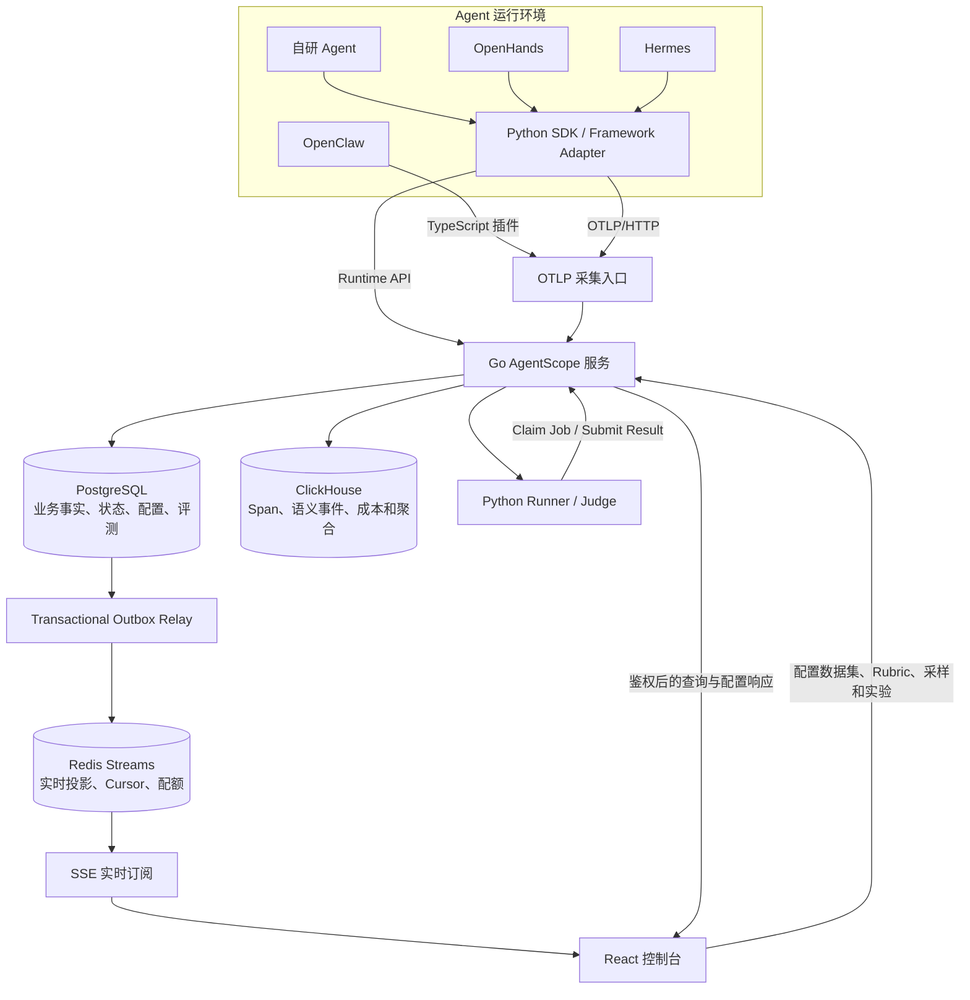

# AgentScope 面试项目深度报告

> 文档定位：面向简历撰写、项目介绍、技术深挖和现场演示。
> 基线版本：2026-07-24，包含 Phase 4 AgentOps 与全仓质量优化合并结果。
> 项目性质：个人主导的企业级方向 AgentOps 平台，不宣称已经完成大规模生产商用。

## 1. 一句话介绍

AgentScope 是一个面向生产 Agent 的可观测、评测与治理平台。它通过 Python SDK、
OpenTelemetry 和框架 Adapter 接入 Agent，把一次 Agent 执行统一建模为 Run，并将
运行状态、思考、LLM、工具、知识库检索、Skill、最终答案、离线实验、人工标注和成本
治理关联在同一条数据链路上。

适合写在简历上的精简版本：

> 独立设计并实现 AgentScope AgentOps 平台，基于 Go、PostgreSQL、ClickHouse、
> Redis、OpenTelemetry 和 React，打通 Agent 实时运行追踪、语义 Trace、数据集与
> 多维评测、多 Judge 校准、实验显著性对比、采集背压及成本异常治理；通过未修改上游
> 源码的 OpenHands 真实任务完成全链路验收。

## 2. 项目解决什么问题

传统 APM 能回答“HTTP 请求是否报错、耗时多少”，但不能直接回答下面这些 Agent 问题：

- Agent 当前在线还是离线，正在执行哪个任务，卡在哪一步；
- Agent 为什么给出这个答案，中间进行了哪些思考和决策；
- 调用了什么模型、工具、知识库和 Skill，各自输入、输出、耗时、Token、成本如何；
- 失败来自模型、工具、检索、业务规则、运行环境，还是采集链路；
- 新 Prompt、新模型、新工具集是否真的比基线更好；
- 离线数据集上的高分能否迁移到线上真实流量；
- LLM-as-a-Judge 是否稳定，多个 Judge 是否一致，安全指标是否应该一票否决；
- 线上坏样本如何进入人工标注，再沉淀为回归数据集；
- 高并发下怎样限流、背压、降级，并保证业务事实不被 Redis 等临时组件绑架。

AgentScope 的核心思路不是简单做一个 Trace UI，而是把“观察问题、形成样本、配置评测、
比较版本、发现回归、回流数据”做成闭环。

## 3. 项目边界与准确口径

### 3.1 已实现并验证

- Python SDK 主动埋点和 OTLP Trace 采集；
- Agent 注册、实例心跳、能力上报和 Run 生命周期状态；
- 思考、LLM、工具、检索、Skill、最终答案等结构化语义记录；
- PostgreSQL Outbox、Redis Streams、SSE 实时事件；
- 数据集、测试用例、Evaluator、Rubric、多维指标和实验 Runner；
- 多 Judge 独立投票、聚合、置信度、分歧和安全 veto；
- 人工 Gold、Judge 校准、线上采样、标注队列和数据集晋升；
- Baseline/Candidate 实验对比、配对统计和回归门禁；
- SDK 有界队列、丢弃统计、采集健康、项目配额、成本 Rollup 和异常检测；
- Hermes Adapter、OpenClaw 原生插件，以及 OpenHands 公开 callback Adapter；
- React 中文控制台及桌面、移动端 Playwright 验收；
- PostgreSQL、ClickHouse、Redis 和真实 OpenHands/真实 LLM 的端到端验证。

### 3.2 仍属于工程化演进方向

- 当前后端是模块化 Go 单体，不是已经拆分的微服务集群；
- 容量验证是本地烟测和故障恢复测试，不等价于生产压测报告；
- 鉴权支持用户、项目成员、项目管理员和 Project Token Scope，但尚未接入企业 SSO；
- 目前主要 SDK 是 Python，TypeScript 侧以 OpenClaw 插件为主；
- 未提供 Kubernetes Helm、跨地域容灾、对象存储归档和完整 SRE 告警体系；
- 异常检测采用 Median/MAD 等稳健统计，不是训练完成的复杂时序模型；
- OpenHands 完成真实 E2E；Hermes 和 OpenClaw 分别完成 Adapter/插件与自动化验证，
  不能把三者都描述为同等强度的生产验证。

面试中应把项目描述为“企业级方向、具备生产治理关键机制的 AgentOps 平台”，而不是
“已经承载百万 QPS 的商业化生产系统”。

## 4. 项目规模与技术栈

合并基线的仓库规模如下。行数包含测试和部分 sqlc 生成代码，因此只用于说明工程体量：

| 范围 | 规模 |
|---|---:|
| Go `cmd/` + `internal/` | 55,705 行 |
| Python SDK、示例和测试 | 24,031 行 |
| Web 源码和 E2E | 14,819 行 |
| PostgreSQL/ClickHouse SQL | 2,771 行 |
| Go 测试文件 | 83 个 |
| Python 测试文件 | 32 个 |
| Web 测试文件 | 20 个 Vitest + 1 个 Playwright E2E |
| Markdown 文档 | 34 个 |

主要技术栈：

| 层次 | 技术 | 选择理由 |
|---|---|---|
| 控制面后端 | Go 1.26.5、Chi、pgx、sqlc | 并发模型清晰、静态类型、部署简单；sqlc 保留 SQL 控制力 |
| 业务事实存储 | PostgreSQL | 事务、约束、生命周期状态、租户关系和复杂业务查询 |
| Trace 分析存储 | ClickHouse | 批量写入、列式压缩、时序聚合和低成本分析查询 |
| 实时投影与限额 | Redis Streams + Lua | SSE 游标、短期事件重放、原子令牌桶和并发计数 |
| 采集协议 | OpenTelemetry OTLP/HTTP | 避免绑定单一 Agent 框架，兼容现有观测生态 |
| Agent SDK | Python 3.11+ | Agent 生态覆盖面广，适合上下文管理器和装饰器式埋点 |
| 前端 | React 18、TypeScript、Ant Design、React Query | 适合运维控制台、数据表格和异步状态管理 |
| 测试与质量 | Go race、pytest、Vitest、Playwright、Ruff、mypy、staticcheck | 覆盖并发、契约、页面、类型、安全和依赖风险 |

## 5. 总体架构



架构不是简单的三数据库堆叠，而是按一致性和查询形态拆分职责：

- PostgreSQL 是业务事实源；
- ClickHouse 是高基数 Trace 明细和分析存储；
- Redis 是可丢失、可重建的实时投影和短窗口计数；
- 前端只通过 Go API 获取数据，不直接访问数据库；
- `Run` 是所有链路的共同业务锚点和跨域关联键，避免“评测结果和 Trace 对不上”。

## 6. 为什么采用模块化单体

当前规模下直接拆微服务会引入服务发现、分布式事务、链路部署和接口版本管理成本。
项目采用一个 Go 进程，但按领域拆分：

- `internal/auth`：会话签名、密码和身份；
- `internal/projects`：项目、成员和 Token；
- `internal/agents`：Agent、版本、实例、心跳和能力；
- `internal/runs`：Run 查询、Runtime 生命周期和 Trace 聚合；
- `internal/ingest`：OTLP 解码、限流、批写和健康事件；
- `internal/evals`：指标、Rubric、Judge 投票、聚合和校准；
- `internal/experiments`：实验、Runner 任务、对比和显著性；
- `internal/sampling`：线上采样策略和决策；
- `internal/annotation`：标注队列、Gold 和数据集晋升；
- `internal/realtime`：事件信封、Outbox Relay、Redis Streams；
- `internal/quotas`：分布式配额；
- `internal/anomalies`：运行指标异常检测；
- `internal/tracestore`：ClickHouse 存储；
- `internal/adapter`：领域接口与 PostgreSQL/ClickHouse 实现；
- `internal/httpapi`：鉴权、参数解析和 HTTP 响应边界；
- `internal/app`：依赖组装。

这种结构保留了未来拆服务的边界，同时让当前事务和本地开发保持简单。拆分条件不是
“模块多”，而应是某个模块出现独立扩缩容、故障隔离、团队所有权或发布节奏需求。

## 7. 核心领域模型：Run

### 7.1 为什么 Run 是统一锚点

一次 Agent 执行可能同时产生：

- Agent 实例状态；
- 一条 OpenTelemetry Trace；
- 多个 Span 和 Span Event；
- 多条 LLM、Tool、Retrieval、Skill、Thought 语义记录；
- 最终答案；
- 一个配置快照；
- 在线评测分数；
- 人工标注；
- 离线实验结果。

如果这些对象各自生成互不相关的 ID，平台只能做多个孤立页面。AgentScope 由 Runtime
API 创建 PostgreSQL `run_id`，SDK 收到该 ID 后将它写入当前 OTLP Span 属性；后端再用
`project_id + run_id + trace_id` 作为跨域关联键。各存储表仍保留自己的主键，`run_id`
不是替代所有主键的“全局唯一事实”。

当前 `runs` 记录只有一个 `trace_id` 字段，主模型按“一次 Run 对应一条主 Trace”工作；
SDK 可以把 `parent_run_id` 放进 metadata，但还没有专门的父子 Run 外键、子 Agent 图或
一对多 Trace 关系表。复杂嵌套/重试场景是后续模型演进点。

### 7.2 Run 生命周期与一致性边界

Runtime Run 支持排队、运行、等待模型、等待工具、等待用户、完成、失败和取消等状态。
当前实现校验状态值是否合法，并将非终态更新、完成、失败拆成明确 API；它还没有转换
矩阵或基于当前状态的 CAS，因此不应夸大为严格有限状态机。一次状态更新的实际步骤是：

1. 读取并校验 Run 的项目归属，更新 PostgreSQL 当前状态；
2. 追加 `run_state_events` 历史；
3. 该历史记录的 PostgreSQL trigger 在同一数据库事务中插入低敏感 Outbox；
4. 后台 Relay 将 Outbox 投影到 Redis；
5. SSE 将状态变化推送到浏览器；
6. 完成后可由采样流程触发线上评测和标注入队。

这里的边界很重要：当前状态更新与历史事件是相继的数据库操作，不是跨步骤单事务；
并发更新、非法跳转保护和状态/历史完全原子化是后续强化项。前端因此能看到“当前状态”
和已成功写入的历史，而不是只展示最终的 completed。

### 7.3 Run Detail 聚合

Run Detail API 将 PostgreSQL 中的 Run 业务信息与 ClickHouse 中的结构化 Trace 合并，
返回：

- Span 树；
- Span Events；
- LLM 调用；
- 工具调用；
- 检索调用；
- Skill 调用；
- 思考记录；
- 最终答案；
- 诊断摘要和错误分类。

语义视图不是从任意 Span 名称临时猜测，而是在采集时将约定属性映射到专门的
ClickHouse 表，既保留原始 Span，也提供面向 Agent 的查询模型。

## 8. Agent 深度可观测

### 8.1 通用语义模型

SDK 为所有 Agent 提供统一语义，而不绑定客服 Agent 或某个框架：

| 语义 | 主要内容 |
|---|---|
| Thought | 阶段、思考摘要、置信度、是否采集内容 |
| LLM | provider、model、输入输出、Token、TTFT、耗时、成本、缓存 Token |
| Tool | 工具名、参数、结果、状态、重试次数、错误 |
| Retrieval | 知识库、query、top-k、返回文档、相关性信息 |
| Skill | Skill 名称、版本、输入、输出、状态 |
| Final Answer | 最终文本、结构化输出、置信度 |
| Span/Event | 任意框架步骤、嵌套关系和补充事件 |

内容字段受采集策略和脱敏规则控制。平台提供“能详细观察”的能力，不意味着默认把
密码、Cookie、完整用户隐私或供应商 Key 写入 Trace。

### 8.2 SDK 接入方式

```python
from agentscope_sdk import (
    configure_tracing, finish_run, init, start_run, trace_llm, trace_tool,
)

server_url, token = "http://127.0.0.1:8080", "ascope_..."
runtime = init(server_url, token, agent_name="research-agent")
tracer = configure_tracing(server_url, token, service_name="research-agent")

with tracer.start_as_current_span("research.run") as root_span:
    trace_id = f"{root_span.get_span_context().trace_id:032x}"
    run = start_run(input="回答研究问题", trace_id=trace_id)
    if run is None:
        raise RuntimeError("Runtime API 未创建 Run")
    root_span.set_attribute("agentscope.run.id", run.id)

    with trace_tool(tracer, "search", arguments_summary="research query") as span:
        documents = search(...)
        span.set_attribute("tool.result_summary", f"{len(documents)} documents")
    with trace_llm(tracer, "answer", provider="deepseek", model="deepseek-chat") as span:
        answer, usage = call_llm(...)
        span.set_attribute("llm.input_tokens", usage.input_tokens)
        span.set_attribute("llm.output_tokens", usage.output_tokens)
    finish_run(output=answer)
```

接入原则：

- SDK 负责统一上下文、Run 生命周期、属性规范和可靠导出；
- Agent 业务代码决定在哪些真实边界埋点；
- 框架 Adapter 只消费公开 callback、hook 或生命周期事件；
- 不通过修改第三方框架源码来“伪造兼容性”；
- 业务执行不能依赖 Trace 成功，采集失败应可诊断但不拖垮 Agent。

### 8.3 Agent 在线状态

Agent 注册后会上报：

- Agent 名称和版本；
- 实例 ID；
- hostname、pid 和 metadata；
- capability；
- 心跳时间；
- 当前活跃 Run 和最近错误。

服务端根据心跳新鲜度和运行记录聚合 active、stale、offline 等状态。控制中心可以查看
Agent 是否在线、实例数量、最近运行、成功率、延迟和错误，而不是把“有历史 Trace”
误当作“当前在线”。

### 8.4 实时事件链路

实时事件采用低敏感统一信封：

```json
{
  "id": "outbox-id",
  "project_id": "project-uuid",
  "run_id": "run-uuid",
  "event_type": "run.semantic.appended",
  "occurred_at": "2026-07-24T...",
  "payload": {
    "semantic_type": "llm"
  }
}
```

关键设计：

- Run 状态历史与对应 PostgreSQL Outbox 由 trigger 在同一数据库事务写入；
- 语义明细先写 ClickHouse，随后 best-effort 写 PostgreSQL Outbox；后一步失败会记录日志，
  不会回滚已落库的语义明细，因此可能出现“详情可查但没有实时通知”；
- Relay 将已领取的 Outbox 逐条发布 Redis Stream；其语义是至少一次投递，而非全局严格
  提交顺序（并发 Relay 与 `SKIP LOCKED` 会形成乱序窗口）；
- Redis 发布用 Outbox ID 做幂等键，默认去重窗口为 7 天；
- SSE 支持 Cursor 重连、心跳和 Cursor 过期 reset；
- 首次连接先写 `: connected` 注释并 flush，避免代理缓冲导致“假实时”；
- Redis 故障不阻断 PostgreSQL 状态写入和 ClickHouse 明细写入；
- Redis 恢复后 Outbox 最终排空。

因此准确保证是：PostgreSQL Outbox 到 Redis 最终一致；ClickHouse 语义明细到
PostgreSQL Outbox 当前仅 best-effort，通知可能永久缺失。它不是整条链路的分布式强
一致或最终一致。Cursor 过期时前端会使相关查询缓存失效并从权威 API 重拉快照，再恢复
订阅。

### 8.5 OpenHands、Hermes 和 OpenClaw

**OpenHands**

- 固定上游版本/提交；
- 通过公开 callback 和 metrics 获取动作、观察、模型和工具信息；
- 不修改上游源码；
- 用 Adapter 转换为 AgentScope 统一事件；
- 已使用真实 DeepSeek OpenAI-compatible API 完成端到端任务；
- 验收后检查上游工作区保持干净。

**Hermes**

- Python Adapter 接收官方运行时 callback/观测钩子；
- 规范化模型、工具、终端、文件和最终答案事件；
- 提供真实接入脚本和回归测试；
- 与平台的 Run、Trace 和语义模型保持一致。

**OpenClaw**

- 以 TypeScript 原生观测插件接入；
- 通过 OpenTelemetry 导出，不要求 Python 运行时；
- 有独立 Node 版本约束、类型检查和 Vitest 测试；
- 证明平台协议层不是只服务 Python 自研 Agent。

三者的价值不只是“多做几个 Demo”，而是反向检验统一语义模型能否覆盖不同 Agent
执行范式。

## 9. 存储设计

### 9.1 PostgreSQL：业务事实

核心表按领域划分：

| 领域 | 代表表 |
|---|---|
| 身份与租户 | `users`、`projects`、`project_members`、`project_tokens` |
| Agent 控制面 | `agents`、`agent_versions`、`agent_instances`、`agent_heartbeats`、`agent_capabilities` |
| 运行 | `runs`、`run_state_events`、`run_snapshots` |
| 数据集与实验 | `datasets`、`dataset_cases`、`experiments`、`eval_jobs`、`eval_case_results` |
| 评测 | `evaluators`、`eval_metric_definitions`、`eval_scores` |
| 可信评测 | `rubric_templates`、`rubric_template_versions`、`eval_judge_votes`、`eval_score_aggregations`、`eval_calibration_runs` |
| 在线回流 | `trace_sampling_rules`、`trace_sampling_decisions`、`annotation_queues`、`annotation_items` |
| 实验对比 | `experiment_comparisons`、`comparison_case_results` |
| 实时与治理 | `realtime_outbox`、`project_quotas`、`project_quota_events`、`operational_anomalies` |

适合 PostgreSQL 的原因：

- 项目成员和资源归属需要外键及事务；
- Run 状态转换需要并发控制；
- Runner Claim 需要租约和防止重复领取；
- Outbox 需要与业务写入原子提交；
- Rubric 版本、Gold 标注和实验配置是不可随意丢失的治理事实。

### 9.2 ClickHouse：观测明细

核心明细表：

- `trace_spans`
- `trace_span_events`
- `trace_llm_calls`
- `trace_tool_calls`
- `trace_retrieval_calls`
- `trace_skill_calls`
- `trace_thoughts`
- `trace_final_answers`
- `trace_ingest_stats`
- `trace_ingest_health_events`

聚合和治理表：

- 15 分钟与 1 小时采集健康 Rollup；
- 小时与天级运行延迟、Token、成本、TTFT、工具错误和采集拒绝 Rollup；
- 对应 Materialized View。

Trace 明细设置 30 天 TTL，降低长期高基数明细成本；聚合数据用于趋势和治理。生产化时
应根据租户等级增加可配置保留期和对象存储归档，而不是所有项目固定 30 天。

### 9.3 Redis：可重建状态

Redis 承担：

- 项目实时事件 Stream；
- SSE Cursor 和短期重放；
- 发布去重；
- 分布式令牌桶；
- 并发连接/任务计数；
- 日预算的短期原子计数。

Redis 不保存：

- Run 最终状态；
- 实验结果；
- Rubric；
- 人工 Gold；
- 唯一一份 Trace；
- 唯一一份费用记录。

这个边界保证 Redis 清空或短暂不可用时，不会丢失业务事实。

## 10. 高并发采集与背压

### 10.1 服务端采集

OTLP 入口的主要保护：

- 请求体大小限制；
- 单批 Span 数限制；
- 项目级限流；
- Project Token Scope 校验；
- 批量解析和批量 ClickHouse 写入；
- 结构化语义提取；
- 接收、拒绝、错误和耗时健康事件；
- 可查询的采集统计页面。

### 10.2 SDK 有界队列

无限队列会在 ClickHouse 或网络变慢时把 Agent 进程内存耗尽。SDK 使用有界队列和批量
导出，并记录：

- 当前 queue depth；
- queue capacity；
- dropped spans；
- export retries；
- export latency。

队列满时优先保护 Agent 主业务，丢弃可观测数据并上报健康指标。这个选择体现了
“可观测系统不能成为被观测系统的单点故障”。

### 10.3 配额策略

项目配额覆盖请求、Span、字节、SSE 并发和成本预算等维度。Redis Lua 保证跨服务实例
原子更新，避免多个 Go 实例分别限流导致总量超卖。

故障策略按风险区分：

- 普通采集限流器故障可以 fail-open，保护业务连续性并记录事件；
- SSE 并发和硬成本预算倾向 fail-closed，避免资源或费用失控；
- PostgreSQL 保存配额配置和审计事件；
- ClickHouse 提供持久用量基线，避免 Redis 重启后预算从零开始。

## 11. 评测系统

### 11.1 为什么不能只看最终答案

Agent 质量由 Agent 与 Harness 共同决定。Harness 包括 Prompt、模型、工具、Skill、
知识库、上下文管理、重试策略和运行环境。相同最终文本可能来自完全不同的过程：

- 正确调用工具后得到答案；
- 模型碰巧猜对；
- 检索到错误文档但答案恰好匹配；
- 违反安全流程却输出表面正确结果。

因此评测需要同时覆盖结果、过程、安全、效率和成本。

### 11.2 数据集

用户可以：

- 创建数据集；
- 定义输入、期望输出和 metadata；
- 选择 Case 创建实验；
- 从线上 Run 创建标注项；
- 人工修订后将标注晋升为 Dataset Case；
- 在 Case metadata 中保留来源 Run/Trace；
- 用新的数据集版本发起回归实验。

数据集不是静态 CSV 附件，而是线上反馈闭环的中间资产。

### 11.3 多维指标

平台支持的指标类别包括：

- `final_answer`
- `tool_correctness`
- `trajectory`
- `rag_groundedness`
- `safety`
- `efficiency`

每个指标可配置权重、阈值和 Rubric。实验总分是按配置聚合的结果，而不是把“Runner
执行成功”误认为“回答质量通过”。

### 11.4 确定性 Evaluator

适合确定性规则的场景优先不用 LLM Judge，例如：

- exact match；
- contains；
- 正则；
- 数值范围；
- 延迟阈值；
- 工具是否成功；
- 是否调用指定工具；
- 检索结果是否包含目标文档；
- 安全关键字或结构化字段。

确定性评测成本低、可复现，适合作为基础门禁。LLM Judge 用于语义质量、帮助程度、
复杂 Rubric 等规则难以覆盖的维度。

### 11.5 Rubric 版本化

Rubric Template 与 Version 分离：

- Template 表示长期评测意图；
- Version 保存某次不可变规则；
- 已发布版本不能被静默修改；
- 实验引用具体版本；
- Dimension 可配置权重、评分等级、阈值和 veto；
- 对比实验可以追溯当时使用的 Rubric。

如果直接修改一条公共 Prompt，历史实验会失去可解释性，因此版本化是可信评测的基础。

### 11.6 多 Judge

每个 Judge 独立执行并保存原始投票：

- Judge 标识；
- Rubric Version；
- Score；
- Passed；
- Reason；
- Error；
- Latency 等证据。

服务端聚合：

- mean、median、trimmed mean 或 majority；
- 启发式 Confidence；
- 分歧度；
- 成功 Judge 数；
- veto 结果；
- 聚合原因。

这里的 Confidence 不是概率校准后的“正确率”，也不是统计置信区间。实现先用
`stddev / 0.5`（上限 1）估算分歧度，再计算
`min(1, valid_votes / required_votes) * (1 - disagreement)`；有效票不足时 Confidence
直接为 0。任一通过结构校验的 Vote 都可以携带 `veto_triggered`，服务端不会再按 Judge
信誉等级二次筛选。安全维度因此能一票否决，但生产化还需要 Judge 信誉、veto 权限和
阈值校准。

### 11.7 Judge 安全

Evaluator 配置不能任意指定环境变量名和 URL，否则会形成两类漏洞：

- 读取服务进程中的任意 Secret；
- 通过自定义 Base URL 发起 SSRF。

因此默认只允许官方供应商密钥和 HTTPS Origin。兼容供应商必须由运维同时加入：

- `AGENTSCOPE_JUDGE_ALLOWED_API_KEY_ENVS`
- `AGENTSCOPE_JUDGE_ALLOWED_BASE_URLS`

Demo 也遵守这个边界，只把当前明确使用的 Key 环境变量名和 Origin 注入白名单，不关闭
校验。

### 11.8 Gold 与校准

人工标注可以标记为 Gold，校准报告比较 Judge 与 Gold：

- 一致率；
- 各维度误差；
- 偏差方向；
- 样本数量；
- 可计算时的 Cohen's Kappa。

它回答“用 LLM 评 LLM，但谁来评 Judge”的工程问题。校准结果不能证明 Judge 绝对
正确，只能量化其在当前 Rubric、标注流程和数据分布上的表现；本次 E2E 的 3 个 Gold
只证明功能链路贯通，样本量不足以形成 Judge 可靠性的统计结论。正式使用还需要盲评、
多标注者一致性、数据泄漏检查和更大样本。

### 11.9 在线评测与采样

全部生产流量都运行昂贵 Judge 不现实，因此使用采样规则：

- random；
- 按 Agent、状态或其他过滤条件；
- 每日预算；
- 分层采样；
- 保存采样决策。

被采样 Run 由 Trace-aware Evaluator 计算效率、最终答案、工具、轨迹、RAG 和安全分数。
低分、失败、低置信或高分歧样本自动进入默认标注队列。

## 12. 实验与统计决策

### 12.1 不可变运行快照

每个 Run 可以保存模型、Prompt、工具、Skill、RAG、代码和环境配置快照。快照在保存前：

1. 递归脱敏 Secret、Authorization、Cookie 等字段；
2. 对 JSON 做稳定规范化；
3. 计算 SHA-256；
4. 以不可变记录保存。

这解决“同名 v1.0 实际配置已经变了”的问题，使实验具有可复现证据。

### 12.2 Harness 元数据

实验记录：

- model provider/name/version；
- prompt version；
- harness version；
- dataset version；
- toolset version；
- skillset version；
- RAG config version；
- feature flags。

评测比较的是整个 Agent 系统，不只是一项模型名称。

### 12.3 Baseline 与 Candidate

对比服务将两个实验按 Case 配对，计算：

- 总体分数变化；
- 通过率变化；
- 各指标变化；
- Case 级改善或回归；
- safety regression；
- 配对统计显著性；
- 回归门禁是否通过。

Case 级回归可以进入标注队列，继续形成数据闭环。

### 12.4 统计显著性

小数据集上 0.02 的均分提升可能只是随机波动。当前实现按 Dataset Case 配对，使用固定
seed 42 做 2,000 次 paired bootstrap，为 score、pass rate、latency 和 cost 计算均值
差、95% percentile CI 与双侧经验 p 值；少于 10 个可比 Case 时返回
`insufficient_sample`。

当前发布门禁只显式识别 score 或 pass-rate 置信区间上界低于 0 的
`significant_regression`；其他情形统一是 `no_significant_change`，包括显著正向提升。
因此它是“阻止可信回归”的基础门禁，不应宣称已经自动认证 Candidate 显著提升。

面试时应说明：

- 显著性不等于业务价值；
- 不显著不等于完全没有提升，可能是样本量不足；
- 当前经验 p 值没有做多重比较校正，也没有功效分析；
- 生产决策还要结合效应量、业务阈值、数据独立性和成本，而不是机械比较 p 值。

## 13. 成本、性能与异常治理

LLM 调用结构化记录包含：

- input/output/total tokens；
- cache read/write tokens；
- TTFT；
- 调用总耗时；
- estimated cost；
- actual cost；
- cost source。

当供应商没有返回实际费用时，根据用户配置的每百万 Token 单价计算估算成本，并明确
`cost_source`，避免把估算值伪装成账单值。

ClickHouse Materialized View 预聚合：

- 运行延迟；
- Token；
- 成本；
- TTFT；
- 工具错误；
- 采集拒绝。

异常检测使用 Median/MAD：

- 相比均值和标准差，对尖峰和长尾更稳健；
- 需要最小基线样本；
- 按 project、agent、model 等维度分组；
- 区分正常、异常和基线不足；
- 记录 observed、baseline、deviation 和状态。

## 14. 多租户与安全

### 14.1 项目隔离

所有项目级资源都必须先验证当前用户是项目成员或管理员。仅凭知道资源 UUID 不能跨项目
读取。质量优化补充了跨租户真实数据库测试，覆盖 Run、Agent、Sampling 和评测等路径。

### 14.2 两类认证

- 浏览器：签名 Session Cookie；
- SDK/Runner/OTLP：Project Token + Scope。

Project Token：

- 明文只在创建时返回一次；
- 数据库保存哈希和可识别前缀；
- 不在 Demo 结果文件中保存；
- 不应通过 URL Query 传播。

### 14.3 会话安全

- 生产必须提供至少 32 字节 `AGENTSCOPE_SESSION_SECRET`；
- HTTPS 部署必须启用 Secure Cookie；
- 服务端不回退到公开默认密钥；
- HTTP Server 设置防御性 timeout。

### 14.4 内容与 Secret 脱敏

SDK 和 Snapshot 对敏感字段递归脱敏。实时 Redis 信封只包含低敏感索引信息，详细内容
仍由受项目鉴权保护的 API 从权威存储读取。

生产继续演进时还需增加：

- 字段级采集策略；
- 租户自定义 PII 规则；
- KMS 和密钥轮换；
- 审计日志；
- 数据导出/删除；
- 合规保留期；
- 更细 RBAC。

## 15. 前端控制台

主要页面：

- 项目列表和项目工作台；
- Run 列表；
- Agent 控制中心；
- Agent 详情；
- Active Runs；
- Run Runtime 状态详情；
- Run Trace/语义时间线与诊断；
- 实验详情和多维报告；
- Baseline/Candidate 对比；
- Sampling Rules；
- Annotation Queues；
- Metric 配置；
- Rubric 模板与版本；
- Judge Calibration；
- Ingest/Quota/Anomaly 治理页。

前端工程要点：

- Route 级懒加载，降低首屏包体；
- React Query 管理服务端状态；
- SSE 更新当前 Run 和语义事件；
- `ValidProjectGuard` 拒绝 `projects/ingest` 这类非 UUID 参数，避免错误路由触发大量
  403；
- 桌面 1440×900 和移动端 390×844 Playwright 验收；
- E2E 将任何 API 403/500 和横向溢出视为失败。

## 16. 一次完整数据流

以 OpenHands 运行并进入回归评测为例：

1. 用户在项目内创建 Project Token；
2. Adapter 注册 Agent 和实例，启动心跳；
3. SDK 调用 Runtime API 创建 Run，并保存脱敏 Snapshot；
4. OpenHands callback 产生 action、observation、LLM 和 tool 事件；
5. Adapter 归一化事件并建立父子 Span；
6. OTLP 批量发送到 Go 采集入口；
7. 后端验证 Token Scope、项目配额、请求大小和批量上限；
8. 原始 Span 与语义记录批量写入 ClickHouse；
9. 语义批写成功后 best-effort 写实时 Outbox；Run 状态历史则通过 PostgreSQL trigger
   与其 Outbox 原子写入；
10. Relay 以至少一次语义发布 Redis Streams；
11. 浏览器 SSE 在 Run 仍为 running 时收到增量事件；
12. Agent 完成，SDK flush 并将 Run 置为 completed；
13. 在线采样命中后，Trace-aware Evaluator 生成多维分数；
14. 低分或高分歧 Run 自动进入 Annotation Queue；
15. 人工修订并标记 Gold；
16. 标注晋升为 Dataset Case，保留来源 Run/Trace；
17. 用户用版本化 Rubric 创建 Baseline/Candidate 实验；
18. Runner 领取任务并执行确定性 Evaluator 和多个 Judge；
19. 服务端保存独立 Judge Vote 并聚合；
20. Compare Service 计算配对差异、显著性和回归门禁；
21. ClickHouse Rollup 与异常检测展示成本、延迟和采集健康。

## 17. API 分组

当前 API 大致分为：

- `/healthz`：健康检查；
- `/api/auth/*`：注册、登录；
- `/v1/traces`：OTLP/HTTP Trace；
- `/api/sdk/*`：Agent 注册、心跳、能力、Run Runtime；
- `/api/projects/*`：项目、Token、Run、Agent、Dataset、Experiment；
- `/api/projects/*/metric-definitions`：指标；
- `/api/projects/*/rubrics`：Rubric 模板和版本；
- `/api/projects/*/eval-calibrations`：校准；
- `/api/projects/*/sampling-rules`：采样；
- `/api/projects/*/annotation-queues`：标注；
- `/api/projects/*/comparisons`：实验对比；
- `/api/projects/*/ingest-stats`：采集健康；
- `/api/projects/*/quotas`：配额；
- `/api/projects/*/anomalies`：异常；
- `/api/projects/*/events`：SSE；
- `/api/runner/*`：任务领取、租约心跳、结果和失败上报。

HTTP Handler 负责认证、参数和响应；业务规则在 Service；SQL 在 sqlc Query/Adapter；
ClickHouse 查询在 tracestore/adapter。这个边界是全仓质量审核的重点。

## 18. 可靠性设计

### 18.1 Runner 租约

Runner 领取 Eval Job 后持有租约并发送心跳，避免 Worker 崩溃后任务永久卡死。结果提交和
失败路径都验证任务归属和状态，防止重复完成或错误 Runner 覆盖结果。

### 18.2 故障隔离

- Redis 故障：业务事实继续写入，Outbox 稍后重放；
- ClickHouse 故障：采集请求返回可诊断错误，不伪装成功；
- ClickHouse 详情查询故障：当前 Runtime Detail 会返回 PostgreSQL 基础信息和空语义
  数组，尚无 completeness/error 标志；这是需要补齐的可见性缺口；
- Judge 失败：保存 Judge Error，按最小成功数和聚合策略决策；
- SDK 队列满：保护业务线程，记录 dropped spans；
- 浏览器断线：按 SSE Cursor 重连；
- Runner 异常：进入 fail 路径并释放任务。

更精确的失败矩阵：

| 失败点 | 已持久化内容 | 对外行为 | 恢复/缺口 |
|---|---|---|---|
| PostgreSQL 不可用 | 当前 OTLP 路径在 Run 关联阶段即失败，通常尚未写本批 ClickHouse | Runtime/业务 API 或 OTLP 报错 | 无跨库事务，客户端按策略重试 |
| ClickHouse 批写失败 | Run 业务事实仍可独立存在 | OTLP 返回 `storage_failed` | SDK 有界重试，最终可能丢 Span |
| ClickHouse 成功、语义 Outbox 失败 | Span/语义明细已存在 | 当前 OTLP 仍返回成功并记日志 | 详情可查但 SSE 可能漏通知，需补偿 |
| Redis/Relay 失败 | PostgreSQL Outbox 仍在 | SSE 延迟或不可用 | Relay 恢复后重试，至少一次 |
| SSE Cursor 过期 | 权威存储不受影响 | 服务端发 `reset` | 前端 invalidate query，重拉快照 |
| Runtime Detail 查询 ClickHouse 失败 | PostgreSQL Run 仍可查 | 当前返回空语义数组 | 缺少 completeness/error 标志 |

这张表也是面试时解释 CAP/一致性边界的关键：项目没有声称用一次事务覆盖 PostgreSQL、
ClickHouse 和 Redis，而是让每类数据按价值选择失败策略，并明确当前补偿机制尚不完整。

### 18.3 幂等与去重

- Redis 发布以 Outbox ID 在默认 7 天窗口内去重；
- Redis Stream Cursor 单调递增，但并发 Relay 下不承诺业务事件的全局严格顺序；
- Runner Job 有明确状态和租约；
- Snapshot 使用稳定哈希；
- 比较以明确 Baseline/Candidate 和 Case 配对；
- Demo 验证使用精确资源 ID，不从数据库“捡一条能通过的数据”。

需要主动说明当前缺口：ClickHouse 明细表使用普通 `MergeTree`，没有 `(project_id,
trace_id, span_id)` 唯一约束；SDK/代理重试同一 OTLP batch 时可能产生重复 Span、语义行
和 Rollup 计数。生产化需要稳定事件 ID、ReplacingMergeTree/版本列或写入侧去重，并对
“ClickHouse 已写、Outbox 未写”这种部分成功建立补偿扫描。

## 19. 测试和质量门禁

`make test-all` 统一执行：

- `gofmt` 检查；
- `go mod verify` 和 `go mod tidy -diff`；
- `go vet`；
- `staticcheck`；
- Go 全仓 `-race` 测试；
- `govulncheck`；
- pytest；
- Ruff lint/format；
- mypy；
- pip-audit；
- shell 语法；
- TypeScript 类型检查；
- Vitest；
- Vite production build；
- npm audit；
- OpenClaw 类型检查、测试和 audit。

合并验收实测：

| 检查 | 结果 |
|---|---|
| PostgreSQL migration | 12 个从空库成功应用 |
| ClickHouse migration | 5 个从空库成功应用 |
| Go 真实数据库 + race | 全部通过 |
| Python | 453 passed |
| Web | 20 个 Vitest 文件、135 项通过；另有 1 个 Playwright E2E 文件 |
| OpenClaw | 9 项通过 |
| Python/Node 依赖审计 | 0 个达到门禁等级的漏洞 |
| Go 漏洞 | 0 个可达漏洞；依赖模块存在 1 个未调用路径提示 |
| 浏览器 | desktop + mobile 通过 |

本次统一门禁于 2026-07-24 在集成提交 `10f686a` 的工作树上执行 `make test-all`，再次
得到上述 Go、Python、Web 和 OpenClaw 结果。空库迁移、真实 OpenHands、容量、恢复和
Playwright 数字来自同日独立验收，详细命令和步骤见 `docs/phase4-verification-report.md`
与 `docs/phase4-capacity-testing.md`。资源 UUID 只有在保留对应数据库时可交互复核，不能
单独当作永久证明。

仓库质量扫描记录为 87/100：0 critical、2 warning、3 suggestion。该分数来自仓库内
`.brooks-lint-history.json` 的 Full Sweep 记录，不代表第三方认证。

## 20. 真实 Phase 4 端到端证据

本轮合并后重新从空数据库验证，不复用旧 Demo 数据：

| 资源 | 结果 |
|---|---|
| Project | `e4454f5d-c6c6-46df-9a6b-fd282f7885d3` |
| OpenHands Run | `a45285e3-55f7-438c-b8c2-8476f55316b1` |
| Trace | `5bc463fd8d939deafdb801d759ee7409` |
| Snapshot | `3e03566a-f169-4098-9ede-aa815d0d711e` |
| Candidate Experiment | `a71b7c55-23db-49f3-a75b-a3a40516ebf2` |
| Comparison | `06d82e65-ad4c-404b-bf8d-6c8de2928a0f` |
| Calibration | `acd59184-a1a3-42a8-a11a-fdcd725088f1` |

真实 OpenHands：

- 固定上游提交 `a375c66a...`；
- 上游源码未修改；
- 使用 DeepSeek OpenAI-compatible API 和 `deepseek-chat`；
- 19 spans；
- 5 thoughts；
- 5 LLM calls；
- 5 tool calls；
- 1 final answer；
- LLM 模型、耗时、Token、估算成本完整；
- TTFT 为正；
- 6 条 Judge votes、3 条聚合、3 条 Gold；
- 没有 Judge error；
- 10 条小时 Rollup；
- Redis Stream 中存在对应 Run；
- Outbox 最终清空。

SDK 背压在刻意施压时记录 3928 条 dropped spans，并将健康事件写入 ClickHouse。这个
数字是故障注入证据，不是正常运行目标。

容量烟测：

| 场景 | 结果 |
|---|---|
| 统一 Demo 内小流量 | 8 requests / 32 spans，P95 410.72ms |
| 独立烟测 | 50 requests / 500 spans，P95 685.53ms |
| 独立烟测错误率 | 0 |
| 独立烟测丢弃率 | 0 |

恢复测试：

- Redis 中断时 Trace 和业务状态继续写入；
- Redis 恢复后 Outbox 在 1830ms 内清空；
- SSE Cursor 重连成功；
- ClickHouse 故障被明确暴露；
- SDK 队列饱和 4 项测试通过。

浏览器测试覆盖：

- 登录；
- Agent 实时状态；
- OpenHands Timeline；
- Snapshot；
- 多 Judge；
- Calibration；
- Experiment Compare；
- Ingest/Quota/Anomaly；
- 无 API 403/500；
- 无页面横向溢出。

## 21. 合并中发现并解决的代表问题

### 21.1 两条长期分支同时修改核心文件

Phase 4 和全仓质量优化都修改了 Go 依赖、配置、Python Runner、Tracing、前端路由和
文档。不能用“ours/theirs”整体覆盖。

解决方式：

1. 先审计两个分支的提交和文件级 diff；
2. 在独立集成 Worktree 创建双亲 merge；
3. 按领域逐个解决冲突；
4. 对冲突文件同时保留功能和质量约束；
5. 从空数据库重新迁移；
6. 运行真实数据库 race、全量质量门禁和真实 E2E。

例子：

- Python Runner 同时保留旧单 Judge 和新多 Judge；
- Tracing 同时保留脱敏/线程安全和 Phase 4 有界队列/成本指标；
- Web 同时保留路由拆包/AntD 6 兼容和 Phase 4 新页面/SSE；
- Go 配置同时保留质量分支安全默认和 Redis/OTLP 新配置。

### 21.2 数据库迁移与测试 Fixture 漂移

Phase 4 给 Sampling Rule 增加了非空 strategy 和 stratification，但质量分支真实数据库
Fixture 按旧 Schema 插入，导致从空库测试失败。

修复不是放宽数据库约束，而是更新 Fixture，使测试与新不变量一致。

### 21.3 Demo Harness 版本不一致

Demo 的 Baseline 声明 target v1.0，但目标注册表只注册 v2.0。表面上实验配置正确，
Runner 执行时会找不到真实目标。

修复为 Baseline/Candidate 都引用可执行的固定 target version，差异由 Harness 配置和
评测输入表达。

### 21.4 Judge SSRF 加固与兼容供应商冲突

质量分支收紧 Judge Key/Base URL 白名单后，Phase 4 Demo 的自定义 OpenAI-compatible
供应商被合理拒绝。

修复没有关闭安全校验，而是让 Demo 将当前明确使用的环境变量名和精确 Origin 加入
运维白名单，并增加测试。

### 21.5 SSE 被代理缓冲

后端建立 SSE 后只 flush header，没有写 body。Vite proxy/浏览器可能等 15 秒后才认为
连接建立，导致服务端其实实时、用户看到却不实时。

修复为连接后立即写标准 SSE comment `: connected\n\n` 再 flush，并增加回归测试。

### 21.6 历史 Demo 中的典型问题

- `/projects/ingest` 被路由识别为 `projectId=ingest`，引发一组 403；
- Agent 语义 Span 都显示 0ms，因为 Demo 在工作结束后才创建并立即关闭 Span；
- Runner Run 与 SDK Runtime Run 各建一条，出现 `unknown` 重复 Run；
- 数据库未应用最新 migration，心跳写入不存在的 `project_id` 列；
- 没配置 Evaluator 时执行成功被展示成质量评分 0；
- CLI 示例参数名与真实 `--server-url` 不一致；
- 多维 Demo 只创建实验但未真正执行或报告 API 不存在。

这些问题推动项目从“能跑的脚本”转向“精确 ID、真实数据、完整退出码、数据库校验和
浏览器校验”的统一验收。

## 22. 关键技术取舍

### 22.1 为什么不用 Kafka

当前 Redis Streams + PostgreSQL Outbox 已能满足本地和中等规模实时视图：

- 运维成本更低；
- 支持 Cursor 和短期重放；
- Redis 同时承担配额；
- PostgreSQL 保留权威事实。

当出现长期事件保留、大量独立消费者、跨区域复制或 Redis Stream 内存成本过高时，
可以把 Publisher/Subscriber 接口替换为 Kafka，而不改变业务事务的 Outbox。

### 22.2 为什么 ClickHouse 不保存所有业务状态

ClickHouse 擅长分析，不适合承载项目成员、任务租约和频繁事务状态。Run 元数据可以
在 ClickHouse 冗余用于查询，但最终状态仍由 PostgreSQL 权威决定。

### 22.3 为什么保留原始 Span 又建语义表

- 只保留原始 Span：查询和 UI 每次都要解析动态 Attribute；
- 只保留语义表：丢失框架未知步骤和通用 OTEL 兼容性。

双层模型兼顾开放性和产品查询效率。代价是写放大和 Schema 演进，需要批写、TTL 和
版本化属性规范控制。

### 22.4 为什么实时事件不包含完整内容

Redis 和 SSE 更容易被长时间保留、缓存和广播。只传低敏感信封，再由页面按鉴权查询
详情，可以降低隐私泄露面和 Stream 内存压力。

### 22.5 为什么用 sqlc 而不是 ORM

- SQL 行为明确；
- PostgreSQL 特性可控；
- 编译期生成类型；
- 批量查询容易优化；
- 避免 ORM 隐式 N+1。

代价是 migration、query 和生成代码必须同步，所以 CI 有 sqlc regenerate/no-drift 和
真实数据库测试。

## 23. 当前不足与下一步

### P0：发布工程化

- 容器镜像、Helm、配置模板和迁移 Job；
- OpenAPI 与 SDK 契约生成；
- 企业 SSO、组织/角色和审计日志；
- Secret Manager/KMS；
- 备份恢复和数据删除流程；
- Prometheus 指标、告警和 SLO。

### P1：规模化

- 将 OTLP Ingest 和异步 Eval Worker 从控制面独立扩缩容；
- 引入持久消息总线或评估 Redis Streams 的容量边界；
- ClickHouse 分布式表、分片、冷热分层和租户保留期；
- Runner Worker Pool、调度优先级和资源隔离；
- 更严格的负载模型、长稳测试和容量曲线；
- 大项目分页、搜索和查询预算。

### P1：评测可信度

- BCa/学生化 Bootstrap、效应量和正向提升结论；
- 多重比较校正；
- Judge 漂移监控；
- 盲评和标注者一致性；
- 数据集去重、污染检测和难度分层；
- Prompt 敏感性、消融实验和 A/B；
- Tool/RAG 仿真环境；
- 评测成本预算与调度。

### P2：生态

- 正式 TypeScript SDK；
- LangGraph、CrewAI、AutoGen 等 Adapter；
- OpenInference/OTEL GenAI Semantic Conventions 映射；
- Webhook 和 CI 回归门禁；
- 数据导入导出；
- Plugin/Adapter 兼容性矩阵。

## 24. 代码导航

| 主题 | 入口 |
|---|---|
| 服务组装 | `internal/app/app.go` |
| HTTP 路由 | `internal/httpapi/router.go` |
| Run 查询与语义详情 | `internal/runs/service.go` |
| Runtime 生命周期 | `internal/runs/runtime.go` |
| OTLP 采集 | `internal/httpapi/ingest_handlers.go`、`internal/ingest/` |
| ClickHouse | `internal/tracestore/`、`clickhouse/migrations/` |
| 实时事件 | `internal/realtime/`、`migrations/00008_phase4_realtime.sql` |
| Snapshot | `internal/snapshots/` |
| 指标与 Rubric | `internal/evals/service.go`、`internal/evals/governance.go` |
| Judge 聚合 | `internal/evals/judge_aggregation.go` |
| 校准 | `internal/evals/calibration.go` |
| 线上评测 | `internal/onlinerval/` |
| 采样 | `internal/sampling/` |
| 标注与晋升 | `internal/annotation/` |
| 实验对比 | `internal/experiments/compare.go` |
| 配额 | `internal/quotas/` |
| 异常 | `internal/anomalies/` |
| Python SDK | `python/agentscope_sdk/` |
| OpenHands Adapter | `python/agentscope_sdk/adapters/openhands.py` |
| Hermes Adapter | `python/agentscope_sdk/adapters/hermes.py` |
| OpenClaw 插件 | `integrations/openclaw/agentscope-observability/` |
| 前端路由 | `web/src/app/App.tsx` |
| 企业 E2E | `scripts/demo-phase4-agentops.sh` |
| 容量与恢复 | `scripts/test-phase4-load.sh`、`scripts/test-phase4-recovery.sh` |

## 25. 面试讲解模板

### 25.1 30 秒版本

> 我做了一个 AgentOps 平台 AgentScope。它不是只展示普通 Trace，而是用 Run 把 Agent
> 在线状态、思考、LLM、工具、RAG、Skill、最终答案和评测结果串起来。后端用 Go，
> PostgreSQL 保存业务事实，ClickHouse 保存高吞吐 Trace，Redis Streams 和 SSE 做
> 实时视图。评测侧支持数据集、版本化 Rubric、多 Judge、人工 Gold 校准、实验显著性
> 对比和线上坏样本回流。我还用未修改源码的 OpenHands 和真实 LLM 跑通了全链路。

### 25.2 3 分钟版本

1. **背景**：普通 APM 不理解 Agent 语义，Demo 式评测又无法连接线上真实问题；
2. **统一模型**：以 Run 为锚点，把 Runtime API 与 OTLP Trace 使用同一 `run_id`；
3. **存储分工**：PostgreSQL 负责事务事实，ClickHouse 负责明细分析，Redis 负责可重建
   的实时流和限额；
4. **实时性**：业务事务写 Outbox，Relay 发 Redis Streams，SSE 支持游标恢复；
5. **可观测**：原始 Span + LLM/Tool/Retrieval/Skill/Thought/Final Answer 语义表；
6. **评测**：确定性规则、多维 Rubric、多 Judge、veto、Gold 校准；
7. **闭环**：线上抽样低分 Run 进入标注，晋升数据集，再做 Baseline/Candidate 回归；
8. **治理**：有界队列、丢弃指标、分布式配额、TTFT/Token/成本 Rollup 和异常检测；
9. **验证**：空库迁移、race、453 个 Python 测试、135 个 Web 测试、真实 OpenHands、
   故障恢复和桌面/移动浏览器全部通过；
10. **边界**：目前是模块化单体和本地容量烟测，下一步是部署、SSO、独立采集 Worker、
    分布式 ClickHouse 和更严格统计。

### 25.3 10 分钟建议顺序

1. 先打开 Agent 控制中心，展示在线实例和活跃 Run；
2. 打开 OpenHands Run，展示实时状态和语义 Timeline；
3. 展开一个 LLM 和 Tool，解释 Token、TTFT、成本、参数和结果；
4. 展示 Snapshot 哈希和脱敏配置；
5. 展示 Rubric、多 Judge 投票、分歧和 veto；
6. 展示 Gold Calibration；
7. 展示 Baseline/Candidate 对比和回归 Case；
8. 展示 Ingest 页面中的队列、丢弃、配额、Rollup 和异常；
9. 画三存储边界和 Outbox；
10. 最后主动说出当前不足和下一步。

## 26. 高频面试问题与参考回答

### Q1：为什么不直接用 LangSmith、Langfuse 或 Phoenix？

这些产品非常成熟，本项目不是证明“必须重造轮子”，而是为了深入实现 AgentOps 的核心
机制。差异化重点是统一 Runtime 状态与 Trace、线上采样到人工 Gold 的闭环、多 Judge
校准、实验显著性和可观测采集治理。生产选型时应从成本、部署、合规和定制需求比较，
而不是默认自研一定更好。

### Q2：如何避免 Runtime Run 和 OTLP Run 重复？

SDK 先创建 Runtime Run，获得 `run_id`，再把同一 ID 注入当前 OTLP 根 Span；后端也能
用 `project_id + trace_id` 回查已有 Runtime Run。Runner 执行实验时同样显式关联任务、
Run 和结果，不根据 agent_name 或时间窗口猜测。这避免了同一次执行产生两条业务 Run，
但不等于 OTLP 明细幂等：同一 batch 重试目前仍可能在 ClickHouse 产生重复 Span，这是
已知改进项。

### Q3：Redis 挂了会怎样？

Redis 只是投影。Redis 挂掉时 PostgreSQL Run/状态事件和 ClickHouse Trace 仍可继续
落库，PostgreSQL Outbox 保留待发布事件；恢复后 Relay 重发。SSE 暂时不可用或延迟，
但权威存储不依赖 Redis。需要注意，状态当前值与状态事件本身仍是两个相继操作。

### Q4：ClickHouse 挂了会怎样？

Trace 采集返回明确错误并记录可诊断信息，SDK 按策略重试、有界缓存或丢弃。Agent 主
业务不应因为 Trace 永久阻塞。Run 业务状态仍可写 PostgreSQL，但 Trace 可能不完整，
当前 Runtime Detail 会吞掉 ClickHouse 查询错误并展示空语义数组，还没有独立的
`trace_incomplete` 标志；采集入口可诊断，但详情页缺失可见性仍需补齐。

### Q5：为什么不用最终一致性把所有东西都异步写？

Run 状态、实验结果和租户关系是业务事实，需要明确事务语义；Trace 明细可批量写入。
对所有内容异步化会让任务状态、权限和结果出现难以解释的窗口。

### Q6：SSE 为什么不用 WebSocket？

当前主要是服务端向控制台单向推送，SSE 原生支持 HTTP、自动重连和事件 ID，运维更
简单。若后续需要双向控制 Agent、交互式终端或高频二进制数据，再考虑 WebSocket。

### Q7：如何控制 Trace 数据量？

SDK 批量与有界队列、服务端请求/Span/字节限额、项目令牌桶、线上采样、ClickHouse
TTL、小时/天 Rollup。生产还应按租户配置保留期和内容采集级别。

### Q8：LLM Judge 自己不可靠怎么办？

不把单次 Judge 当真值：保存独立 Vote，使用多个 Judge、置信度、分歧和最小成功数；
安全维度可 veto；用人工 Gold 做校准；确定性规则优先；持续监控 Judge 漂移。

### Q9：为什么要版本化 Rubric？

评测 Prompt 或评分标准一旦变化，同一个分数就不再可比。实验绑定不可变版本，才能
复现、审计和比较。

### Q10：如何判断 Candidate 真有提升？

同一 Dataset Case 配对比较，观察均分、通过率、各维度、safety regression、效应方向
和 bootstrap CI，再结合成本和延迟。当前自动结论重点识别显著回归；即使正向 CI 不
跨 0，也仍返回 `no_significant_change`，所以“显著提升”需要读取指标证据人工判断，
不能把当前门禁结果直接说成提升认证。

### Q11：怎么避免 N+1？

报告和对比服务使用批量读取 Eval Scores；Run Detail 将各类 ClickHouse 记录按 Run
批量查询；质量门禁有 Adapter 批量测试。新增页面时先定义批量 Query，而不是循环调
Service。

### Q12：如何做多租户隔离？

会话得到 user ID，每个项目资源访问先做成员/管理员校验；Project Token 绑定 project
和 scope；查询同时带项目归属；真实 PostgreSQL 测试覆盖跨项目 UUID 访问。

### Q13：Project Token 泄露怎么办？

数据库只存哈希；明文只创建时返回；支持 Scope；日志和 Demo 文件禁止保存；生产还应
增加过期、轮换、撤销、使用审计和 Secret Manager。

### Q14：为什么异常检测用 Median/MAD？

LLM 延迟和成本常有长尾，均值/标准差容易被尖峰拉动。Median/MAD 对异常值更稳健。
同时设置最小样本并展示基线不足，避免小样本误报。

### Q15：什么情况下拆微服务？

采集入口需要独立水平扩容、Judge Worker 需要 GPU/外网隔离、团队所有权分离或控制面
与数据面发布节奏不同。拆分时优先保持现有 Service Interface 和 Outbox 边界。

### Q16：这个系统最大的技术难点是什么？

不是画 Trace，而是跨 Runtime API、OTLP、三种存储和异步 Runner 保持统一身份、一致
边界和真实验收。第二个难点是把主观 LLM Judge 变成可追溯、可校准的工程系统。

### Q17：如何证明是实时而不是运行完再展示？

E2E 在 Run 仍处于 running 时等待 SSE `run.semantic.appended`，确认语义事件先到，
之后才收到 completed。并验证代理首包 flush 和 Cursor 重连。

### Q18：如何证明 Adapter 没修改 OpenHands？

固定上游提交，Adapter 使用公开 callback/metrics，验收结束执行上游 `git status
--porcelain` 必须为空，并记录 commit。

### Q19：背压为什么允许丢 Span？

可观测数据的重要性低于 Agent 主业务可用性。无限重试或无限缓存会造成更大事故。
关键是丢弃必须可计量、可告警，并可通过采样和容量规划降低。

### Q20：目前最诚实的性能结论是什么？

本地 50 请求/500 Span 的烟测错误率和丢弃率为 0，P95 约 686ms；它证明链路可重复和
有基础保护，不证明生产峰值容量。生产上线前必须在目标硬件、数据分布和并发模型下做
阶梯压测与长稳测试。

### Q21：当前 Run 是严格状态机吗？

不是。当前实现有合法状态枚举、非终态/终态 API 分流和状态事件历史，但没有转换矩阵、
版本号 CAS 或“当前状态更新 + 历史事件”的单事务封装。面试中应称为 Run 生命周期协议。
下一步应在 SQL 更新条件中带 expected status/version，并把状态、事件和 Outbox 放进一个
事务，拒绝终态回退及并发覆盖。

### Q22：PostgreSQL、ClickHouse、Redis 如何保证一致？

不使用跨库分布式事务。PostgreSQL 状态事件与 Outbox 局部原子；ClickHouse 语义明细
成功后 best-effort 写语义通知；Redis 是可重建投影，由 Relay 至少一次发布。因此状态
通知的保证更强，语义通知存在部分成功窗口。当前通过日志和权威详情查询降低影响，生产
还需补偿扫描、稳定事件 ID 和完整性标志。

### Q23：SSE Cursor 过期时会不会丢页面状态？

服务端检测 Cursor 早于 Stream 最老记录时发送 `reset: cursor_expired`。前端收到后不会
假设可以补齐全部历史事件，而是 invalidate React Query 缓存，从 PostgreSQL/ClickHouse
API 重拉当前快照，再继续接收新事件。这样事件流负责“通知变化”，权威 API 负责“恢复
状态”。

## 27. STAR 项目故事

### 27.1 实时一致性

**Situation**：Agent 页面只能运行结束后刷新，Redis 故障还可能导致状态丢失。
**Task**：在不让 Redis 成为事实源的前提下提供实时状态和语义事件。
**Action**：设计 PostgreSQL Transactional Outbox、Redis Streams、幂等 Relay、SSE
Cursor/reset，并补充 Redis 停机恢复和代理 flush 测试。
**Result**：真实 OpenHands 在 running 阶段即可展示语义事件；Redis 中断后权威写入
继续，恢复后 Outbox 约 1.83 秒排空。

### 27.2 可信评测

**Situation**：单 Judge 分数不可解释，修改 Prompt 后历史结果不可复现。
**Task**：让评测可以审计、校准并用于版本发布。
**Action**：实现版本化 Rubric、独立 Judge Vote、置信聚合、安全 veto、人工 Gold、
Calibration 和配对显著性。
**Result**：真实闭环保存 6 票、3 个聚合和 3 个 Gold，可从 Calibration 和 Comparison
页面追溯决策。

### 27.3 长期分支集成

**Situation**：Phase 4 功能分支和全仓质量分支长期并行演进；合并结果相对 Phase 4
父提交改变 218 个文件，combined diff 涉及 120 个冲突解决文件，直接选择一侧会丢功能
或安全加固。
**Task**：完整合并并证明两侧能力都保留。
**Action**：在独立 Worktree 做双亲 merge，逐域解决冲突，从空库应用全部 migration，
跑真实数据库 race、全量质量门禁、真实 OpenHands、容量、恢复和 Playwright。
**Result**：合并提交包含 21,434 行新增和 3,418 行删除；Python 453 项、Web 135 项及
真实 E2E 全部通过，并额外发现和修复 Fixture 漂移、Demo 版本、Judge 白名单和 SSE
代理缓冲四类集成缺陷。

## 28. 简历要点候选

根据岗位篇幅选择 3 到 5 条，不要全部堆上：

- 设计 Go 模块化单体 AgentOps 控制面，以 `Run` 统一关联 Runtime 状态、OTLP Trace、
  Agent 语义事件、评测结果和人工反馈，提供 70+ 组项目级 API；
- 基于 PostgreSQL Transactional Outbox、Redis Streams 与 SSE 实现可重放实时事件，
  在 Redis 故障下保持权威写入并完成恢复后最终一致；
- 设计 ClickHouse 原始 Span + Agent 语义表 + Materialized View 分层模型，支持 LLM、
  Tool、RAG、Skill、Thought、Token、TTFT、成本和异常趋势查询；
- 实现数据集、版本化 Rubric、多 Judge 投票、置信/分歧聚合、安全 veto、Gold 校准和
  Baseline/Candidate 配对显著性，形成线上坏样本到回归数据集闭环；
- 实现 Python SDK 有界队列、批量导出、脱敏和背压指标，并通过 Redis Lua 完成跨实例
  项目配额；
- 使用公开生命周期事件接入 OpenHands/Hermes，并提供 OpenClaw TypeScript 插件；以
  未修改上游源码的 OpenHands 和真实 LLM 跑通 PostgreSQL、ClickHouse、Redis、SSE、
  Judge 和浏览器全链路；
- 建立 Go race、pytest、mypy、Vitest、Playwright、依赖审计和空库 migration 质量
  门禁，合并基线达到 Python 453 项、Web 135 项自动化通过。

## 29. 现场演示清单

### 29.1 准备

```bash
make dev
```

配置真实模型后：

```bash
make demo-phase4-agentops
```

不要现场依赖历史数据库数据。统一 Demo 会创建一个账号、一个项目和一组精确关联资源。

### 29.2 展示

1. 用 Demo 输出的账号登录；
2. 打开 Agent 列表，确认 OpenHands Agent/实例；
3. 打开对应 Run，展示状态、Trace 树和语义 Timeline；
4. 展开 LLM 和 Tool，讲 Token、TTFT、成本与真实动作；
5. 查看 Snapshot；
6. 查看 Rubric、多 Judge 和 Calibration；
7. 查看 Experiment Comparison；
8. 查看 Ingest/Quota/Anomaly；
9. 终端展示 `make test-all` 的摘要；
10. 主动画三存储边界和 Outbox。

### 29.3 演示失败时的处理

- 不切换到伪造结果；
- 先看后端日志和 Demo 的精确资源 ID；
- 模型供应商失败与平台失败分开说明；
- ClickHouse/Redis 故障可借机解释恢复设计；
- 不在投屏中打印 API Key、Project Token 或数据库密码。

## 30. 最后总结

AgentScope 最有价值的部分不是页面数量，而是下面四个闭环：

1. **运行闭环**：Agent 注册 → Run 状态 → 语义 Trace → 实时页面；
2. **质量闭环**：线上采样 → 自动评测 → 人工标注 → Gold/数据集；
3. **发布闭环**：不可变快照 → Baseline/Candidate → 显著性 → 回归门禁；
4. **治理闭环**：背压/配额 → 成本性能 Rollup → 异常 → 容量与恢复验证。

面试时要强调这些闭环背后的工程理由，同时诚实说明当前仍是可部署、可验证的企业级方向
项目，而不是已经经过真实大规模生产流量证明的商业系统。诚实边界本身也是工程判断力
的一部分。
